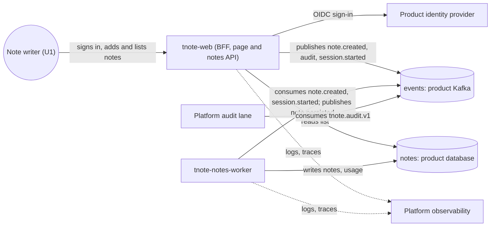
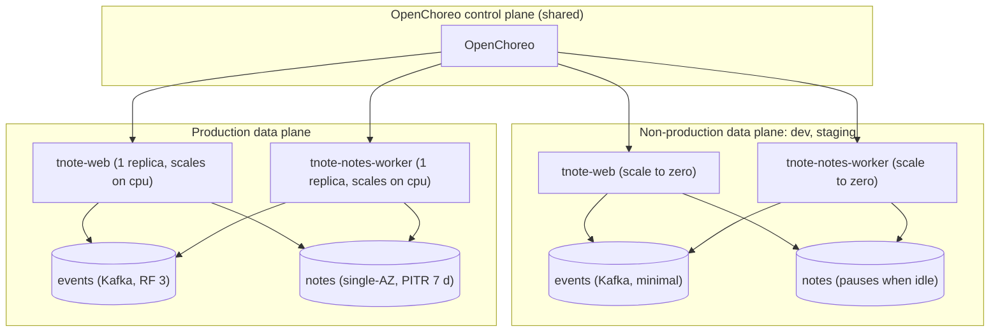
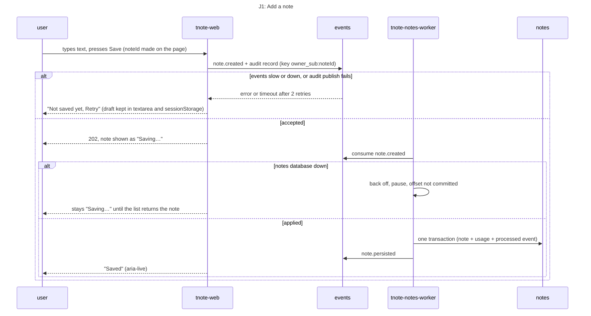

I fixed the DynamoDB finding, but **I did not fix the three cost findings, and I don't think any compliant design can.** VX-16 requires every server-side design to have Kafka and a data store. Those two clusters cost about $161–$176 a month in the check's estimate, roughly 30× the $5 run budget. Rather than invent a cheaper service the catalog doesn't have, I escalated the cost under VX-10 (ADR-TNOTE-5). The gate has to choose a way forward before build (see Agent notes).

**What changed:**
- **DynamoDB:** removed. Notes now use the platform's default database.
- **Shared Kafka lane:** removed. I couldn't confirm it exists, and the cost check charged for a cluster anyway. Notes events now use the platform's default Kafka.
- **Resources:** this section is now omitted, because the platform defaults cover everything.

**What I couldn't check:** `catalog.yaml` isn't in `/work/work`, and every shell command fails with `bwrap: loopback: Failed RTM_NEWADDR`. So the catalog names of the default Kafka and database are unconfirmed. Saving to `/work/work/architecture.md` was refused again, so the full document is below.

---

# Product architecture: Tiny Notes

## Context
Tiny Notes (TNOTE, org `valxel-eval`) is one web page for one person. They type a short plain-text note, save it, and see their saved notes listed newest first. Nothing else is in scope: no editing, deleting, search, sharing or mobile app.

Who and what it talks to:
- **The note writer (U1)** uses a browser. The browser reaches the product only through the BFF (`tnote-web`) and never holds tokens (VX-17).
- **The product identity provider (`idp`).** The BFF runs the OIDC code flow with PKCE and keeps the tokens on the server.
- **The product's Kafka (`events`, platform default).** It carries the note, session and audit events (VX-16).
- **The product database (`notes`, platform default).** This is the read model for the list. The worker writes it and the BFF reads it.
- **The platform audit lane (`audit`).** It keeps `tnote.audit.v1` append-only and tamper-evident, with a write-once backup, for at least 6 years (VX-15).
- **Platform observability (`obs`).** It holds logs, traces, metrics and SLO alerts (VX-8).
- **OpenChoreo.** It deploys both components to the two data planes. A person promotes to production at G6 (VX-3, VX-19).

Data class: **general**. Notes are one person's personal data, so they stay in one allowed region in the user's country. The gate has not named that country yet.

Run cost: on the platform defaults this design costs about $161 a month in pilot and $176 a month in growth and scale (the check's estimate). The run budget is $5/$5/$10. **I found no compliant server-side design in the catalog that meets this budget**, so the cost is escalated under VX-10 (ADR-TNOTE-5).

Traceability: there is no PRD with AC ids yet, so this design traces to the brief's scope items. When the PRD exists, the planner should replace these with its AC ids.

| Id | Scope item |
|---|---|
| S1 | Add a note |
| S2 | List notes, newest first |
| S3 | Sign-in, with no tokens in the browser |
| S4 | Audit record for each note created |
| S5 | SLOs, logs and traces |
| S6 | "Session started" and "note persisted" events |
| S7 | WCAG 2.1 AA |

## Components
- tnote-web (bff): serves the single page and the notes API behind it; owns sign-in and the 30-minute session rule, publishes one tnote.note.created.v1 event plus one audit record per add, and reads the newest-first list from the notes database (S1, S2, S3, S4, S5, S6, S7) [repo: valxel-eval/tnote-web]
- tnote-notes-worker (event-worker): applies note and session events to the notes database once and in order, and publishes tnote.note.persisted.v1 (S1, S6) [repo: valxel-eval/tnote-notes-worker]

## Component contracts
**tnote-web endpoints.** Every endpoint declares the permission it needs, and an undeclared route returns 403 (VX-17). The calling workload is checked by mesh mTLS. The person is checked with the session's access token, which the identity provider issued for the audience `tnote`.

| Endpoint | Permission | Behaviour |
|---|---|---|
| `GET /` | signed-in session | Returns the page. Redirects to the identity provider when there is no session. |
| `POST /api/notes` | `tnote.notes:create` | Body is `{noteId: UUIDv7, text: 1–2,000 chars}`. Publishes the event and the audit record, then returns 202. Writes no database (VX-16). Returns 409 if the noteId belongs to another owner and 400 if the id is malformed. |
| `GET /api/notes?cursor&limit≤50` | `tnote.notes:read` | Runs `WHERE owner_sub = session sub ORDER BY note_id DESC`. Record access is checked per owner. |

The session cookie is HttpOnly, Secure and SameSite=Strict, and mutating calls also carry a CSRF token. Sessions are kept in the platform session store.

**Session rule (S6).** When a page load follows at least 30 minutes of inactivity, tnote-web publishes `tnote.session.started.v1`, keyed by the session id. This is best effort.

**Accessibility (S7).** The page has:
- a labelled textarea
- a Save button that works from the keyboard
- an `aria-live` status that announces "Saving…", "Saved" or "Not saved yet"
- text contrast of at least 4.5:1
- a line stating that notes are for general information

axe tests run in CI.

**Audit (S4).** Each record holds:
- who: the user's sub, acting through tnote-web
- the action: `note.create`
- the noteId
- the outcome

It never holds the note text.

**Events** on the product's Kafka:

| Topic | Key | Producer | Consumer | Retention |
|---|---|---|---|---|
| `tnote.note.created.v1` | `owner_sub:noteId` | tnote-web | tnote-notes-worker | compacted, kept until a tombstone (the replay source) |
| `tnote.session.started.v1` | session id | tnote-web | tnote-notes-worker | 30 days |
| `tnote.note.persisted.v1` | noteId | tnote-notes-worker | metrics (PG1) | 30 days |
| `tnote.audit.v1` | noteId | tnote-web | platform audit lane | at least 6 years, owned by the audit lane |
| `tnote.note.created.v1.dlq` | same as source | tnote-notes-worker | operators (alert) | 30 days |

Every topic has 1 partition. That is enough at this load, and it gives total order.

**Notes database** (the platform's default relational store):

| Table | Key | Purpose |
|---|---|---|
| `notes` | `(owner_sub, note_id)` | Holds the note text. UUIDv7 sorts by time, so descending order returns the newest first. |
| `usage_daily` | `day` | Daily `sessions` and `notes_persisted` counts (PG1, PG2) |
| `processed_events` | `event_id` | Dedup marker, purged after 30 days |

The worker writes the note or usage update and the `processed_events` row in one transaction. A conflict on `event_id` means the event was already applied, so each event applies exactly once. Replaying `tnote.note.created.v1` and `tnote.session.started.v1` rebuilds every table. Schema changes are expand-then-contract migrations, run by the worker (VX-4).

## Resources
This section is omitted because the platform defaults cover the design: the product's Kafka and the product database. No other managed service is used. The DynamoDB table from the previous draft is removed because it isn't in the catalog.

Each component reaches only what it needs, through its own workload identity and with no keys (VX-19):
- **tnote-web** writes `tnote.note.created.v1`, `tnote.session.started.v1` and `tnote.audit.v1`, and has a read-only database role.
- **tnote-notes-worker** reads `tnote.note.created.v1` and `tnote.session.started.v1`, writes `tnote.note.persisted.v1` and the DLQ, and has read-write access to the notes database.

## Shared services
- Product identity provider: sign-in for the single user, with tokens issued for the `tnote` audience (VX-17).
- Platform session store: server-side sessions for tnote-web.
- Platform audit lane: append-only, tamper-evident storage of tnote.audit.v1, with a write-once backup kept at least 6 years (VX-15).
- Platform observability: structured logs with the trace id, OpenTelemetry traces that continue W3C traceparent, and SLO dashboards and alerts (VX-8).
- OpenChoreo: build, then deploy to dev, staging and production; production promotion by a person at G6.

## Load
- J1: Add a note (user): 20 a day per user; tnote-web 20 requests; tnote-notes-worker 20 events
- J2: Open the page and list notes (user): 10 a day per user; tnote-web 20 requests; tnote-notes-worker 10 events

**J1 (add a note).** Each add is 1 BFF request. It publishes 1 note.created event, which the worker consumes, plus 1 audit record and 1 note.persisted event.

**J2 (open the page).** Each visit is 2 BFF requests: the page load and the list fetch. It produces at most 1 session.started event.

**Peak and growth.** The busy hour is 3× the 12-hour average, still well under 0.01 requests a second. Notes grow by about 15 MB a year (20 a day × up to 2 KB). Audit records add about 25 MB over 6 years.

## Scaling
- tnote-web: stateless; scales on cpu; first limit: the identity provider's sign-in rate limit, then BFF CPU on page rendering (one replica serves several orders of magnitude more than the brief's load)
- tnote-notes-worker: stateless; scales on cpu; first limit: the single partition caps it at one active consumer, then database write latency (add partitions keyed by owner only if users are added, which A6 rules out for year one)

## Failure
- tnote-web -> idp: timeout 3000 ms; retries 1; idempotency: none, the authorization code is single-use and a failed exchange restarts sign-in; when down: "Sign-in is unavailable, try again shortly", and a user already signed in keeps working until the session expires
- tnote-web -> events: timeout 2000 ms; retries 2 with an idempotent producer; idempotency: noteId as event key; when down: POST returns 503, the note stays in the textarea and in sessionStorage (text only, no token) with "Not saved yet, Retry"; session.started is dropped and logged, so PG1 may undercount
- tnote-web -> notes: timeout 1000 ms; retries 1; idempotency: none, reads only; when down: the page shows "Couldn't load notes, Retry" and adding still works
- tnote-notes-worker -> notes: timeout 2000 ms; retries 5 with exponential backoff, then the consumer pauses without committing; idempotency: processed_events row written in the same transaction; when down: new notes are accepted and stay "Saving…" until the database is back
- tnote-notes-worker -> events: timeout 2000 ms; retries 3; idempotency: offsets committed only after the database commit, noteId as key for note.persisted; when down: events are reprocessed and the marker absorbs duplicates, so the user sees no difference
- notes: recovery: tier 3 targets 24 h recovery time and 24 h data loss; daily backups with 7-day point-in-time recovery meet both, and the tables can also be rebuilt by replaying the compacted tnote.note.created.v1 topic, so no accepted note is lost
- events: recovery: replication factor 3 across availability zones (platform default); the compacted note topic is never trimmed by time, so the replay source stays complete

An event that still fails after the retries goes to `tnote.note.created.v1.dlq` and raises an alert. Then the consumer resumes.

If the audit record can't be published, the create fails with 503 and the page keeps the draft (ADR-TNOTE-4). VX-15 only requires this for PHI and payments products, so it is stricter than the rule.

Blast radius: if Kafka goes down, adding notes stops but the list keeps working. If the database goes down, the list stops but adding keeps working. Nothing outside TNOTE depends on either component.

## NFRs
- NFR-1 (performance): p95 ≤ 500 ms for POST /api/notes and ≤ 800 ms for GET /api/notes with 50 notes, measured at tnote-web
- NFR-2 (reliability): p95 ≤ 5 s from a 202 to the note appearing in the list, and 0 notes lost after a 202, checked by a replay-consistency test
- NFR-3 (availability): 99.0% monthly for add and list (tier 3), measured at tnote-web
- NFR-4 (security): 100% of endpoints declare a permission and undeclared routes return 403; 0 tokens reach the browser; mTLS between all workloads; each component holds only the topic and database rights listed under Resources (VX-17, VX-19)
- NFR-5 (privacy): 0 occurrences of note text in logs, traces, metrics, audit records or usage events, verified by an automated scrubbing test on every PR; data stored in 1 allowed region
- NFR-6 (privacy): an erasure request is completed within 30 days through the erasure runbook (ADR-TNOTE-3)
- NFR-7 (accessibility): WCAG 2.1 AA, with 0 axe violations in CI and a keyboard-only manual check before G6 (VX-9)
- NFR-8 (observability): 100% of requests traced from tnote-web through Kafka headers to tnote-notes-worker, with the trace id in every log line, and SLO burn alerts on NFR-1 to NFR-3 (VX-8)
- NFR-9 (compliance): exactly 1 audit record per note created on tnote.audit.v1, kept ≥ 6 years (VX-15)
- NFR-10 (maintainability): unit-test line coverage ≥ 90% in both repos, enforced on every PR (VX-11)
- NFR-11 (scalability): production runs 1 replica per component, and non-production scales to zero with the database pausing when idle; run cost is tracked monthly against the budget the gate sets (ADR-TNOTE-5)

## Erasure runbook
To erase a note, an operator publishes a tombstone for each `owner_sub:noteId` to `tnote.note.created.v1`.

When the worker applies a tombstone, it deletes the matching row. Point-in-time recovery copies age out within 7 days, and compaction removes the original events within days. All of this falls within 30 days.

Audit records hold only ids, so they stay unchanged.

## ADRs
- ADR-TNOTE-1: Store notes server-side through the platform event path, BFF to Kafka to worker to database (alternatives: browser localStorage only; consequences: notes are durable and follow the user across devices, "note persisted" can be measured, and the design follows VX-15/16/17; it brings Kafka and database cluster cost, see ADR-TNOTE-5)
- ADR-TNOTE-2: Two components, with the BFF also serving the notes API (alternatives: a separate tnote-notes provider behind the BFF; consequences: one fewer always-on deployable and no token-exchange hop; the internet-facing component holds publish rights on three topics and a read-only database role, so a compromised BFF can add notes or read the owner's notes but can't write the store; split out a provider if a second consumer of the API ever appears)
- ADR-TNOTE-3: The compacted tnote.note.created.v1 topic, keyed owner_sub:noteId, is the replay source, and erasure works by tombstone (alternatives: per-note encryption keys with crypto-shredding; time-based retention plus snapshots; consequences: there is no key service to run, the store can be rebuilt from the topic, and erasure finishes after compaction, within the 30-day window)
- ADR-TNOTE-4: The page generates the noteId (UUIDv7) and uses it as the idempotency key end to end; a failed audit publish fails the create (alternatives: server-assigned ids with dedup by content hash; best-effort audit; consequences: retries never duplicate notes and no note exists without its audit record; the API must reject malformed ids and ids owned by another user)
- ADR-TNOTE-5: Use the platform's default Kafka and database, and escalate the run cost under VX-10 instead of meeting the $5/$5/$10 budget (alternatives: an on-demand DynamoDB table, rejected because it isn't in the catalog; a shared multi-tenant Kafka lane, not confirmed to exist, and the cost check still charged for clusters; browser-only storage served by a stateless BFF, likely within budget but it gives up durability, cross-device use and server-side measurement, and it is a scope change for the gate; consequences: about $161 a month in pilot and $176 in growth and scale, which the gate must accept, re-scope or decline before build)

## Context diagram


## Deployment diagram


## Journey flows


```mermaid
sequenceDiagram
  title J2: Open the page and list notes
  participant user
  participant tnote-web
  participant idp
  participant events
  participant notes
  user->>tnote-web: GET /
  alt not signed in
    tnote-web->>idp: OIDC authorization code flow with PKCE
    alt idp down
      tnote-web-->>user: "Sign-in is unavailable, try again shortly"
    else signed in
      idp-->>tnote-web: tokens (kept server-side)
    end
  end
  tnote-web->>events: session.started (if ≥30 min inactive, best effort)
  user->>tnote-web: GET /api/notes?limit=50
  tnote-web->>notes: select by owner_sub, newest first
  alt notes database slow or down
    notes-->>tnote-web: error or timeout
    tnote-web-->>user: "Couldn't load notes, Retry"; adding still works
  else success
    notes-->>tnote-web: notes
    tnote-web-->>user: list rendered, newest first
  end
```

## Agent notes
- Changed: I removed the DynamoDB table, which isn't in the catalog, and the unconfirmed shared Kafka lane. The design now uses only the platform defaults, so the Resources section is omitted.
- Changed: I did not make the cost findings pass. Every compliant server-side design needs Kafka (VX-16) and a data store, and those clusters account for the $161–$176 a month. That is about 30× the $5 run budget, and each month costs nearly three times the whole $60 year-one budget. Under VX-10 I am escalating this rather than bending a rule or naming a service the catalog doesn't have (ADR-TNOTE-5).
- Open (gate decision, blocks build): choose one of these:
  - **(a) Keep this design** and raise the run budget to about $165 a month for pilot and $180 for growth and scale.
  - **(b) Switch to browser-only storage.** tnote-web serves the static page and notes live in the browser's localStorage, with no Kafka, database, identity provider or audit. This likely fits $5, but notes are lost when the browser is cleared and don't follow the user across devices. PG1 and PG2 could then be measured only from anonymous page metrics.
  - **(c) Ask the platform for a shared multi-tenant Kafka and database tier.** That needs a platform ADR, outside this product.

  I recommend (b) for the pilot. PG2 at day 30 is the keep-or-stop check, and (a) would spend about $500 before that answer arrives. Revisit (a) if the user keeps the app.
- Assumed: a "session" is a page load after at least 30 minutes of inactivity. Notes are capped at 2,000 characters, because "short" wasn't defined.
- Assumed: the notes database runs in a single availability zone in production. Tier 3 doesn't justify Multi-AZ, and point-in-time recovery plus topic replay meet the 24 h recovery target.
- Traded off: the BFF serves the notes API itself. This saves a deployable and a token exchange, at the cost of giving the internet-facing component publish rights (ADR-TNOTE-2).
- Traded off: creates fail when the audit record can't be published. This is stricter than VX-15 requires for general data (ADR-TNOTE-4).
- Open: I couldn't read `catalog.yaml`. It isn't in the working directory, and every shell command fails with `bwrap: loopback: Failed RTM_NEWADDR`. So the catalog names of the default Kafka and database are unconfirmed.
- Open: which country is the user in? That decides the allowed region and the erasure law.
- Open: will the PRD's AC ids map onto S1–S7?
- Open: should a minimal delete be in scope? Today erasure is only an operator runbook, not something the user can do on the page.